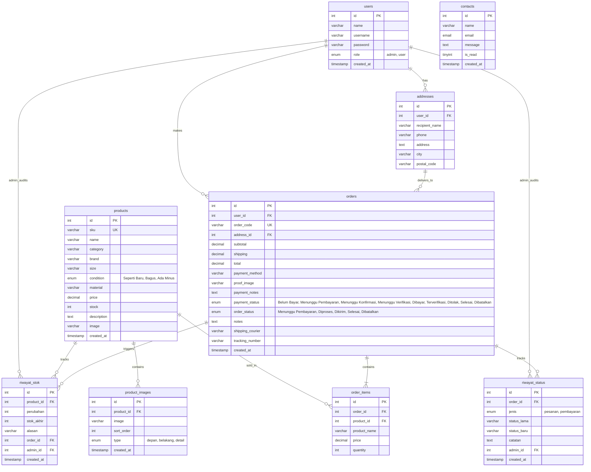
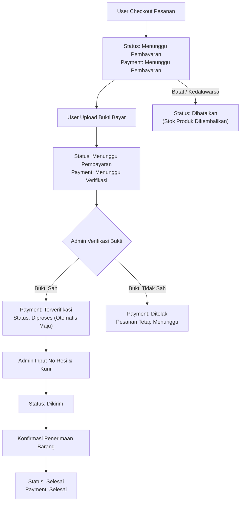

# ALUR SISTEM & DIAGRAM RELASI DATA (ERD)
## SECONDSPACE // CURATED PRELOVED STREETWEAR PLATFORM
**Versi:** 2.0 (Fase 5 - Struktur Database Baku & Normal)  
**Kepatuhan:** 100% PHP Native, Bebas JavaScript, Zero Emoji, Integritas Relasional Penuh.

---

## 1. ENTITY RELATIONSHIP DIAGRAM (ERD)

Struktur basis data SecondSpace terdiri dari 9 tabel terhubung dengan foreign key formal dan penghapusan kolom kembar/redundant:

---

## 2. ATURAN HIMPUNAN KONDISI PRODUK (OPSI A)

Sesuai persetujuan pemilik proyek, sistem SecondSpace murni menerapkan satu himpunan label kondisi:

| Nilai ENUM Basis Data | Label Tampilan Pengguna | Deskripsi Standar |
| :--- | :--- | :--- |
| `Seperti Baru` | Seperti Baru | Kondisi mulus sempurna tanpa noda, robek, atau jejak pemakaian berarti. |
| `Bagus` | Bagus | Kondisi terawat rapi, warna solid, minus wajar pemakaian normal preloved. |
| `Ada Minus` | Ada Minus | Memiliki minus tertentu (misal: pudar halus, kikis minor) yang dicantumkan jelas pada deskripsi. |

**Lokasi Definisi:** Terpusat di `/shared/config.php` pada konstanta `DAFTAR_KONDISI_PRODUK`.

---

## 3. ALUR STATUS TRANSAKSI & PEMBAYARAN (STATE MACHINE)

---

## 4. INTEGRITAS TRANSAKSI & MUTASI STOK PRELOVED

1. **Sifat Barang 1-of-1**: Setiap produk preloved merupakan pakaian unik dengan stok 1 (`stock = 1`).
2. **Pencatatan Audit Riwayat**:
   - Setiap pengurangan stok saat checkout dicatat di tabel `riwayat_stok`.
   - Setiap perubahan status pesanan atau pembayaran diverifikasi melalui `ubah_status_pesanan()` dan `ubah_status_pembayaran()`, lalu diaudit otomatis pada tabel `riwayat_status`.
   - Jika pesanan dibatalkan, kuantitas stok dikembalikan tepat satu kali ke tabel `products` dan dicatat ke `riwayat_stok`.
